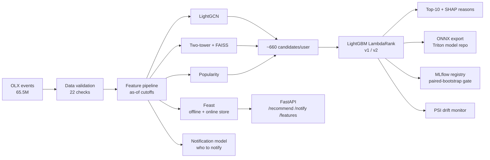

# PathRank — Which Jobs Should a Job Seeker See, and When Should We Tell Them?

PathRank is my end-to-end project for learning how a jobs marketplace recommends jobs and decides when to send notifications. I built the whole loop myself: candidate retrieval (a graph model and a two-tower model), a LightGBM ranker, a notification model that decides who to notify, a feature store, model export for serving, and the MLOps around it (data checks, a model registry with a statistical promotion gate, drift monitoring).

I ran it on **real job-board data: 65.5M events from OLX Jobs (Kaggle)**, on my MacBook Air (M3) and on a single A100 in Google Colab. Every number in this README comes from a file in `results/`.

---

## Why this project exists (and what changed along the way)

I wanted a recommender project I could defend line by line in an interview, not a notebook with one accuracy number. So I set myself three rules:

1. **No future leakage.** Every feature is computed "as of" a cutoff time, using only data from before it.
2. **Every claim needs a baseline and a confidence interval.** "Model B is better" means the paired bootstrap interval is above zero.
3. **Report what went wrong.** Several of my first results were wrong. The sections below say which ones and how I found out.

The original plan used the CareerBuilder job recommendation dataset (job titles, descriptions, user profiles, locations). When I tried to download it, Kaggle returned `403 Forbidden`: the competition closed in 2012 and no longer accepts new participants. I switched to **OLX Jobs Interactions**, a public dataset of real clicks, saves and contact events on a job board. It is much bigger, but it has **no job text, no user profiles and no locations**, only *who interacted with which job, and when*. That one fact shaped most of what I learned.

---

## Key results

Full dataset: 65.5M events → 2.57M users with at least 2 interactions × 176,644 jobs → **46.4M user-job pairs**. Time-based split: train on Feb 12–22, 2020, test on Feb 23–25.

| What I measured | Full data (2.57M users) | 300K-user sample |
|---|---|---|
| Ranker NDCG@10 (popularity baseline) | **0.0169** (0.0018) → **9.4×** | 0.0179 (0.0019) → 9.3× |
| Ranker v2 vs v1, paired bootstrap | **+10.2%**, 95% CI [+0.0005, +0.0026] | +40.2%, CI [+0.0039, +0.0064] |
| Same comparison as a simulated 50/50 A/B test | p = 0.136, **not significant** | p < 0.001 |
| Two-tower recall@100 (ID embeddings only) | **0.039** | 0.010 |
| LightGCN recall@100 | 0.065 | 0.080 |
| Share of test interactions that reach the ranker | 16.8% | 16.1% |
| Notification model AUC (recency-only baseline) | **0.865** (0.815) | 0.864 (0.815) |
| Users to notify to reach 80% of next-2-day applicants | 39.2% (61% fewer sends than everyone) | 40.1% |
| Feast online feature lookup, p50 | 0.68 ms for 2.57M users | 1.01 ms |
| LightGCN training on one A100 | 34.8M edges, ~47 s/epoch | 4.1M edges, ~3.8 s/epoch |

**What these mean, in plain words:**

- The ranker is about **9× better than "show everyone the most popular jobs"**. The absolute NDCG looks small (0.017) because each user has ~160K open jobs to choose from and the test window is short. That's why I always show the baseline next to it.
- The better ranker (v2, with extra context features) wins on the **same users** at full scale (+10%, interval above zero). But if you ran it as a real 50/50 A/B test on 10K users, you **wouldn't detect** the difference (p = 0.136). Offline, that tells me the gain is real; online, it tells me how big the test needs to be.
- The two-tower model only became useful with more data: recall@100 went from **0.010 to 0.039** (3.7×) going from 300K users to 2.57M. With no job text, it can only learn an embedding per job ID, and those need volume.
- **Retrieval is the ceiling, not ranking.** Only ~17% of the jobs people actually interacted with in the test window make it into the candidate list, so the ranker can never find the other 83%.

---

## What I got wrong, and how I found it

### 1. A label leak, caught by the drift monitor

OLX has no job posting dates, so I estimated each job's "end date" as its last interaction + 14 days. That last interaction can be **after** the cutoff, so two things quietly used the future:

- the filter that decides which jobs are "open" at the cutoff, and
- a ranker feature, `job_days_left`.

I didn't spot this by reading code. The drift monitor did: `job_days_left` had a PSI of **9.2** between the training and test windows (anything above 0.25 counts as drift). Tracing why led me to the leak.

**The fix** (`job_window` in `pathrank/features/pipeline.py`): a job is "open" if it had activity in the 7 days before the cutoff or was newly posted in the test window, and `job_days_left` is unknown (NaN) on datasets without real posting dates. A regression test checks that changing interactions *after* the cutoff doesn't change the catalog.

**What surprised me:** NDCG went **up** after removing the leak. The leaked feature looked completely different in the training and test windows, so the ranker learned a rule that broke at test time. The registry's promotion gate confirmed it: the leak-free model beat the leaky one on the same users (paired +0.0033 NDCG, 95% CI [+0.0019, +0.0047]). That comparison is in `results/RESULTS_olx_300k_mac_leakfix.md`. That run also used fewer LightGCN epochs, so I don't attribute the whole gain to the fix.

### 2. I almost blamed the wrong component

Combining all candidate sources scored recall@100 = 0.036, lower than LightGCN alone (0.081). My first reading was "merging sources hurts". That was wrong: the metric only looked at the top 100 after merging, but the ranker sees **all ~660 candidates**. I added a metric for that (`union_candidates_recall_all`), and the full candidate set catches more than any single source.

### 3. My first "full dataset" run wasn't

The full-data config wrote to the same folders as the 300K-user config. The pipeline saw an existing feature store and **silently reused the 300K sample**. The log said `300,000 users` and I almost reported it as the full run. The fix was separate output folders for each config. Now I check the user count in the log before trusting any run.

### 4. The Mac and Colab runs used different users

Same seed, same code, different results. The 300K-user sample depended on how pandas orders tied counts, which differs between pandas versions. Each run was internally valid, but comparing Mac vs Colab numbers wasn't. I fixed it by sorting user IDs before sampling.

### 5. The registry gate rejected models, correctly

On Colab, three later challengers were **not** promoted: one was +0.0008 NDCG with an interval crossing zero, and two were worse (−0.0020 and −0.0023). I first read this as a bug. It wasn't: the gate only promotes when the improvement is statistically clear. One real limitation I found: the champion had been trained on a different user sample, so a stricter gate would reset when the data version changes.

---

## What works on this dataset, and what doesn't

Because OLX has interactions only, some parts of the system have nothing to work with. I left them in the code (they're built for datasets with text and locations) but I don't claim results for them:

| Component | On OLX |
|---|---|
| LightGCN graph retrieval | **Best single retriever** (12.4% candidate recall at full scale) |
| Two-tower retrieval | Works, but only at full scale (ID embeddings) |
| LightGBM LambdaRank ranker + SHAP | Works; top features: 7-day job popularity, title overlap, days since the user was last active |
| Notification classifier (will this user apply in the next 2 days?) | Works; beats the recency baseline on AUC (0.865 vs 0.815) and PR-AUC (0.771 vs 0.645) |
| Return-time regression (how many days until the user comes back?) | Works, but only a small win: MAE 0.646 days vs 0.711 for always guessing the median. It feeds the "when to send" decision |
| Analytics dashboard (`analytics.html`) | Weekly cohort retention, apply funnel and the notification targeting curve. No click-through rate: the data has no notification logs, so I don't fake one |
| TensorFlow/Keras two-tower baseline | Same features and loss as the PyTorch tower, evaluated on the same test users. Built and tested; not run on OLX yet (`make tf-baseline`) |
| Evidently drift report | Second opinion next to PSI (Evidently picks a test per feature). Built and tested; not run on OLX yet |
| Text retrieval | No job text → no signal (recall@100 0.0009) |
| Location popularity | No locations → identical to global popularity |
| Fairness re-rank (non-metro exposure) | No locations → nothing to re-rank (0% non-metro jobs) |
| LLM notification agent | Runs with a template backend, so its 100% pass rate is trivial. Supports Anthropic and OpenAI with the same prompts; needs an API key for a real eval |
| Sponsored-job slot (monetization) | An expected-value rule for when a paid job is worth a slot. Only tested on made-up numbers: OLX has no ad data |

The "title overlap" feature is interesting here: job "titles" are just `job <id>`, so on this data it mostly says *"the user has already interacted with this job"*. Since the test only counts new interactions, I think the ranker learned to push already-seen jobs down. The cleaner fix is to filter seen jobs during retrieval.

---

## Architecture



---

## Things I built to keep myself honest

- **As-of features.** One class (`AsOf`) computes features for training, evaluation and the live API, so training and serving can't drift apart because of two implementations.
- **Feature store parity checks.** Feast's offline (point-in-time) and online values are compared with the pipeline's own values on every run, on a sample of users. At full scale (2.57M users in the online store): max difference 0.0.
- **A data validation gate.** 22 checks run before training. On OLX it correctly raises 4 warnings (no text, no locations).
- **Statistical promotion.** A new model becomes champion only if its paired-bootstrap NDCG gain over the current champion is above zero.
- **Determinism.** LightGCN on CPU gave slightly different results on identical runs, enough to move NDCG in the third decimal. I wrote a custom backward pass to fix it, and a test checks it. GPU training is not bit-reproducible (CUDA uses atomic adds).
- **Model export checks.** The ONNX towers match PyTorch to within 1.8e-7. At full scale only 79.9% of top-10 lists are identical between ONNX and PyTorch, even though outputs match that closely. My guess is near-tied scores flipping order, but I haven't confirmed it.

---

## evalwright: the tracing and evaluation SDK I built for this

To evaluate the notification agent and trace API requests, I wrote a small SDK in **Python and TypeScript** that share one wire protocol (`sdk/`). It has no runtime dependencies, retries with backoff and a circuit breaker, and never blocks or crashes the app it's tracing. A contract test sends both SDKs' traces through a 30% injected failure rate with zero loss and zero duplicates.

Using it on PathRank found two real concurrency bugs: Feast's SQLite online store shared one connection across threads, and the notification frequency cap wasn't atomic. Both are fixed and covered by tests. Details: [`sdk/README.md`](sdk/README.md).

---

## Limitations

- **Interactions only.** No job text or locations, so cold-start users (no history) get NDCG 0.0009 vs 0.0242 for users with history. That's the biggest gap.
- **Short window.** Two weeks of data, a ~3-day test window. Job ages near the start look artificially new (the job age feature drifts for this reason, not because of a leak).
- **Notification results are targeting, not causation.** There are no randomized sends in the data, so I can say who is likely to apply, not how many extra applications a notification causes.
- **Not deployed or load-tested.** The Triton configs and ONNX/TensorRT export are tested against a local test server, and there's a Cloud Run deploy script (canary + rollback) and GitHub Actions CI, but I haven't run real Triton/TensorRT on an NVIDIA GPU or deployed the API to Cloud Run yet.

---

## What I'd do next

1. **Fix cold start:** trending jobs for new users, plus a separate retrieval path for them.
2. **Raise the retrieval ceiling** above 17%: filter already-seen jobs, give LightGCN more candidate slots, tune the two-tower at full scale.
3. **Real agent eval** with an Anthropic or OpenAI key instead of the template backend, and run the TensorFlow baseline and Evidently report on OLX.
4. **Run Triton + TensorRT on a GPU** and measure throughput and p99 latency.

---

## Tech stack

| Area | Tools |
|---|---|
| Models | PyTorch (LightGCN, two-tower), TensorFlow/Keras (two-tower baseline), LightGBM LambdaRank, scikit-learn, FAISS, SHAP |
| Data / features | pandas, PyArrow, Feast (SQLite / Redis online store) |
| Serving | FastAPI, ONNX Runtime, Triton model repository, TensorRT build scripts, Prometheus |
| MLOps | MLflow (tracking + registry), PSI + Evidently drift monitoring, GitHub Actions, Docker, Cloud Run deploy script |
| Agent / evals | LangGraph, Anthropic or OpenAI API, evalwright (my Python + TypeScript SDK) |
| Hardware | MacBook Air M3 (CPU), NVIDIA A100 40 GB on Google Colab |

---

## How to run it

**Setup (Mac or Linux, Python 3.11–3.13):**

```bash
python3.12 -m venv .venv && source .venv/bin/activate
pip install -U pip uv && uv pip install -r requirements.txt
make smoke        # whole pipeline on small synthetic data (a few minutes)
make test         # PathRank tests: leakage, determinism, feature-store parity, registry gate
make sdk-test     # evalwright: Python + TypeScript suites
```

**Real data (OLX, 300K-user sample):** put a Kaggle API token in `~/.kaggle/access_token`, then:

```bash
uv pip install "kaggle>=1.8"
make olx          # downloads ~2.1 GB, runs every stage
```

On a Mac this takes about 1.5 hours, mostly LightGCN on CPU.

**Optional extras** (TensorFlow baseline, Evidently report, OpenAI backend), after `make olx`:

```bash
uv pip install -r requirements-extra.txt
make tf-baseline CFG=configs/olx.yaml                                    # Keras two-tower vs PyTorch, same test users
python scripts/run_pipeline.py --config configs/olx.yaml --stages monitor,report   # adds the Evidently report

export OPENAI_API_KEY=...          # or ANTHROPIC_API_KEY=...; set OPENAI_MODEL to pick a model
make agent-eval CFG=configs/olx.yaml                                     # real LLM agent eval instead of the template
```

**Full dataset (Colab A100, High-RAM):** upload the repo, add `KAGGLE_API_TOKEN` as a Colab secret, then:

```bash
python scripts/run_pipeline.py --config configs/olx_full.yaml --stages all
```

The full run takes ~50 minutes, mostly writing 2.57M users into the Feast online store. Check that the log says `2,570,548 users` before trusting the results.

**Serve it:**

```bash
PATHRANK_CONFIG=configs/olx.yaml uvicorn pathrank.serve.app:app --port 8080
curl localhost:8080/recommend/<user_id>
```

---

## Repository layout

```
pathrank/
├── data/          OLX, XING and CareerBuilder loaders, synthetic data generator
├── features/      as-of feature pipeline, leak-free job catalog (job_window)
├── retrieval/     LightGCN, two-tower, popularity, FAISS index
├── ranking/       LambdaRank ranker, pair features, SHAP reasons
├── notify/        notification models, frequency cap
├── featurestore/  Feast definitions, materialization, online context
├── inference/     ONNX export, Triton repository, backends
├── mlops/         data validation, MLflow registry + promotion gate
├── monitoring/    PSI drift
├── agent/         LangGraph notification agent + guardrails
└── serve/         FastAPI app
configs/           olx.yaml (300K sample), olx_full.yaml (full data), xing.yaml, synthetic, CI
results/           result reports and logs for every run quoted here
sdk/               evalwright (Python + TypeScript)
tests/             unit + end-to-end tests
```

---

**Rudra Brahmbhatt** · MS Computer Science, Texas State University · [github.com/Rudra2122](https://github.com/Rudra2122)
