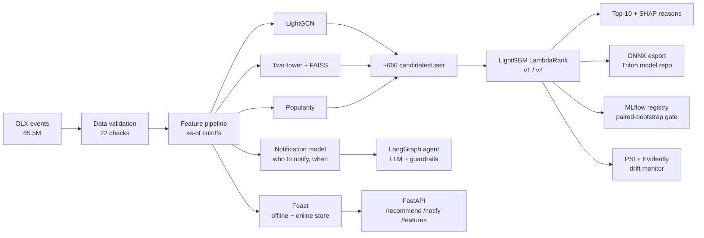

# PathRank — Job Recommendations and Notification Targeting

PathRank is an end-to-end, personalized job recommendation and notification system built as a multi-stage ranker: embedding-based retrieval (a two-tower deep learning model with FAISS) and a graph neural network (LightGCN), a LightGBM LambdaRank ranker with SHAP explanations, notification models for the user lifecycle (a classifier for who to notify, a regression for when), an LLM agent that writes the notification behind code-level guardrails, a Feast feature store, ONNX/Triton export, and MLOps (data validation, MLflow experiment tracking and a registry with a statistical promotion gate, drift monitoring).

It runs on **real job-board data: 65.5M events from OLX Jobs Interactions (Kaggle)**, trained on a MacBook Air M3 and a single NVIDIA A100 (Google Colab). All numbers below come from the reports in `results/`.

---

## Dataset

OLX Jobs Interactions: clicks, saves and contact events on a job board over two weeks of 2020. It has **no job text, user profiles or locations**, only who interacted with which job and when.

- 65.5M events → 2.57M users (≥2 interactions) × 176,644 jobs → **46.4M user-job pairs**
- Time-based split: train Feb 12–22, test Feb 23–25
- All features are computed as of a cutoff time, using only earlier data

The CareerBuilder dataset (with job text and locations) was the original target, but the competition no longer accepts downloads (Kaggle returns `403 Forbidden`). Loaders for CareerBuilder and XING are kept in `pathrank/data/`.

---

## Key results

| Metric | Full data (2.57M users) | 300K-user sample |
|---|---|---|
| Ranker NDCG@10 (popularity baseline) | **0.0169** (0.0018), **9.4×** | 0.0179 (0.0019), 9.3× |
| Ranker MAP@10 (popularity baseline) | 0.0075 (0.0008) | 0.0077 (0.0008) |
| Ranker v2 vs v1, paired bootstrap | **+10.2%**, 95% CI [+0.0005, +0.0026] | +40.2%, CI [+0.0039, +0.0064] |
| Same comparison as a simulated 50/50 A/B | p = 0.136 (not significant) | p < 0.001 |
| Two-tower recall@100 | 0.039 | 0.010 |
| LightGCN recall@100 | 0.065 | 0.080 |
| Test interactions reaching the ranker | 16.8% | 16.1% |
| Notification classifier AUC (recency baseline) | **0.865** (0.815) | 0.864 (0.815) |
| Users notified to reach 80% of next-2-day applicants | 39.2% (61% fewer sends) | 40.1% |
| Feast online lookup, p50 | 0.68 ms | 1.01 ms |
| LightGCN training, one A100 | 34.8M edges, ~47 s/epoch | 4.1M edges, ~3.8 s/epoch |

- The absolute NDCG is low because each user has ~160K open jobs and a 3-day test window; the 9.4× lift over popularity is the meaningful number.
- Experimentation: ranker v2 beats v1 on the same users at full scale, but a 50/50 A/B test on 10K users would not detect the gain (p = 0.136). An online test would need more traffic.
- The two-tower model (ID embeddings only, since there is no job text) improved 3.7× with more data.
- **Retrieval is the bottleneck:** only ~17% of test interactions reach the candidate set.

### Additional results (300K sample, `results/RESULTS_olx_300k_mac_extras.md`)

| Component | Result |
|---|---|
| Return-time regression | MAE 0.646 days vs 0.711 for a median baseline (small gain); drives send timing |
| TensorFlow/Keras two-tower | recall@100 0.016 vs 0.011 for the PyTorch tower on the same users; both close to popularity (0.009) |
| LLM agent (OpenAI gpt-4o-mini) | 50/50 messages passed guardrails on the first try, 3/3 adversarial cases caught, 3.0 s p50. Judge score 0.858 [0.825, 0.887] (self-graded, so a sanity check only) |
| Evidently drift report | 5 of 21 features flagged vs 1 by PSI; both rank `job_age_days` highest |
| Analytics dashboard | Cohort retention, apply funnel, notification targeting curve (`analytics.html`) |

### Not measurable on this dataset

| Component | Reason |
|---|---|
| Text retrieval (NLP: sentence-transformers / TF-IDF embeddings) | No job text |
| Location popularity | No locations |
| Fairness re-rank (responsible AI: job exposure across locations and degree types) | No locations or degree data |
| Sponsored-slot rule | No ad data (unit-tested only) |
| Notification click-through | No notification logs |

---

## Issues found and fixed

1. **Label leak.** OLX has no posting dates, so job end dates were estimated from the last interaction, which can fall after the cutoff. This leaked into the open-job filter and the `job_days_left` feature. PSI monitoring flagged it (PSI 9.2). Fixed in `job_window` with a regression test; the leak-free model beat the leaky one (paired +0.0033 NDCG, CI [+0.0019, +0.0047]).
2. **Misleading merge metric.** Recall@100 after merging candidate sources looked worse than LightGCN alone, but the ranker sees all ~660 candidates. Added `union_candidates_recall_all` to measure the full set.
3. **Stale feature store.** The full-data config reused the 300K sample's output folder. Each config now has separate output directories.
4. **Non-reproducible sampling.** User sampling depended on pandas tie ordering, so Mac and Colab runs used different users. User IDs are now sorted before sampling.
5. **Empty column broke Evidently.** After the leak fix, `job_days_left` is always empty on OLX and Evidently rejected it. Empty columns are now dropped and listed in the report.

---

## Architecture



**Design notes**

- One feature implementation (`AsOf`) serves training, evaluation and the API, so training and serving cannot diverge.
- Feast offline and online values are checked against the pipeline on every run (max difference 0.0).
- A model is promoted only if its paired-bootstrap NDCG gain over the champion is above zero.
- LightGCN CPU training is deterministic (custom backward pass, enforced by a test).
- ONNX towers match PyTorch within 1.8e-7.

---

## evalwright SDK

A tracing and evaluation SDK in Python and TypeScript with one shared wire protocol (`sdk/`), used for the agent eval and API tracing. It has no runtime dependencies and includes retries, a circuit breaker and idempotent delivery; a contract test shows zero loss and zero duplicates under 30% injected failures. It surfaced two concurrency bugs in PathRank (a shared SQLite connection in Feast and a non-atomic frequency cap), both fixed. See [`sdk/README.md`](sdk/README.md).

---

## Limitations

- Interactions-only data: cold-start users score NDCG 0.0009 vs 0.0242 for users with history.
- Two-week window with a ~3-day test period.
- Notification results measure targeting, not causal uplift (no randomized sends in the data).
- Triton/TensorRT are validated against a local test server but not benchmarked on a GPU; the Cloud Run deploy script has not been run.

## Next steps

1. Cold-start handling: trending jobs and a separate retrieval path for new users.
2. Raise retrieval recall above 17%: filter already-seen jobs, allocate more LightGCN candidates.
3. Use a separate judge model and human-labeled examples for the agent eval.
4. Benchmark Triton + TensorRT on a GPU.

---

## Tech stack

| Area | Tools |
|---|---|
| Models | PyTorch, TensorFlow/Keras, LightGBM, scikit-learn, FAISS, SHAP |
| Data / features | pandas, PyArrow, Feast (SQLite / Redis) |
| Serving | FastAPI, ONNX Runtime, Triton, TensorRT, Prometheus |
| Experiment tracking / MLOps | MLflow, PSI + Evidently, GitHub Actions, Docker, Cloud Run (script) |
| Agent | LangGraph, OpenAI / Anthropic APIs, evalwright |
| Hardware | MacBook Air M3, NVIDIA A100 40 GB (Colab) |

---

## Running it

```bash
python3.12 -m venv .venv && source .venv/bin/activate
pip install -U pip uv && uv pip install -r requirements.txt
make smoke            # full pipeline on small synthetic data
make test             # unit + end-to-end tests
```

**OLX, 300K-user sample** (Kaggle token in `~/.kaggle/access_token`; ~1.5 h on an M3):

```bash
uv pip install "kaggle>=1.8"
make olx
```

**Optional extras:**

```bash
uv pip install -r requirements-extra.txt
make tf-baseline CFG=configs/olx.yaml                                              # Keras baseline
python scripts/run_pipeline.py --config configs/olx.yaml --stages monitor,report   # Evidently report
export OPENAI_API_KEY=...                                                          # or ANTHROPIC_API_KEY
make agent-eval CFG=configs/olx.yaml                                               # LLM agent eval
```

**Full dataset** (Colab A100, High-RAM, ~50 min):

```bash
python scripts/run_pipeline.py --config configs/olx_full.yaml --stages all
```

**API:**

```bash
PATHRANK_CONFIG=configs/olx.yaml uvicorn pathrank.serve.app:app --port 8080
curl localhost:8080/recommend/<user_id>
```

---

## Repository layout

```
pathrank/
├── data/          OLX, XING, CareerBuilder loaders; synthetic generator
├── features/      as-of feature pipeline, leak-free job catalog
├── retrieval/     LightGCN, two-tower, popularity, FAISS
├── ranking/       LambdaRank ranker, features, SHAP
├── notify/        notification models, frequency cap
├── featurestore/  Feast definitions and online context
├── inference/     ONNX export, Triton repository
├── mlops/         data validation, registry + promotion gate
├── monitoring/    PSI + Evidently drift
├── agent/         LangGraph agent + guardrails
└── serve/         FastAPI app
configs/   tf_baseline/   results/   sdk/   tests/
```

---

**Rudra Brahmbhatt** · MS Computer Science, Texas State University · [github.com/Rudra2122](https://github.com/Rudra2122)
