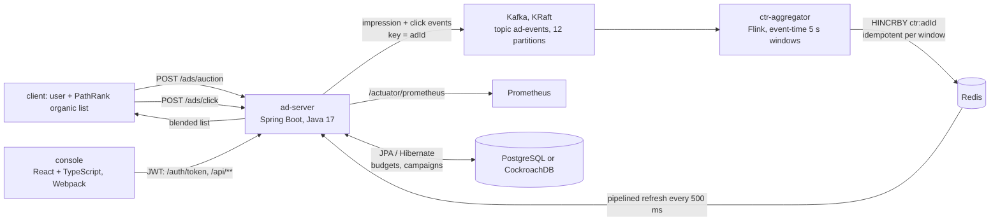

# PathRank ads: sponsored jobs with a real-time CTR loop

PathRank ranks jobs for a user. Job boards make money by letting employers pay to promote a job, so I wanted to see what it takes to mix paid results into those rankings without wrecking them. This folder is that: a Java/Spring Boot ad server that runs a second-price auction for sponsored slots in the PathRank result list, a Flink job that learns each ad's click-through rate from a Kafka stream of impressions and clicks, and a click simulator that closes the loop on real OLX users and jobs.



v2 added the bottom two arrows and Java 21 (see [v2](#v2-shared-budgets-virtual-threads-valkey-auth-and-a-console)).

## What each piece does

| Piece | Code | What it does |
|---|---|---|
| ads-core | `ads-core/` (plain Java, no framework) | The ad logic, so it can be unit tested without Spring: GSP auction, budget ledger, frequency cap, slot blending, CTR smoothing, Thompson sampling |
| ad-server | `ad-server/` (Spring Boot 3.3) | `POST /ads/auction`: takes a user and the organic list, returns the list with sponsored jobs blended in. `POST /ads/click`: charges the click once. `GET /ads/stats`. Sends every impression and click to Kafka. Micrometer/Prometheus metrics |
| ctr-aggregator | `ctr-aggregator/` (Flink 1.20, DataStream API) | Reads `ad-events`, counts impressions and clicks per ad in event-time tumbling windows, and adds them to `ctr:<adId>` in Redis. Late and malformed events are counted, not silently dropped |
| campaigns | `sim/make_campaigns.py` | 500 campaigns on real OLX jobs, plus the hidden CTR the simulator clicks with |
| click simulator | `sim/click_sim.py` | Replays real OLX user ids against the server and clicks with the hidden CTR × position bias. Then checks what the system learned |
| load test | `bench/auction.js` (k6) | Throughput and latency of `POST /ads/auction` |
| bench | `bench/ads_bench.sh` | All of the above end to end, writes `results/RESULTS_ads.md` |

## How an auction works

1. **Filter.** Drop campaigns whose job is already in the organic list, whose advertiser can't afford one more click at their bid today, or that this user has already seen 3 times this hour.
2. **Rank.** Score = bid × pCTR (expected cost per impression). Ranking by bid alone would let a high bid buy the slot for a job nobody clicks.
3. **Price.** Generalized second price: the winner at position i pays the smallest price per click that still beats position i+1, `rankScore[i+1] / pCTR[i] + $0.01`, never above its bid, never below the $0.05 reserve.
4. **Blend.** Each winner only goes in if `SlotBlender` says its expected revenue beats the relevance it costs the organic list. This is a Java port of `sponsored_slot()` in `pathrank/notify/policy.py`, and `SlotBlenderTest` checks it against numbers from the Python version.
5. **Log.** Every sponsored row gets an impression id; the impression goes to Kafka. A click on that id is charged once (compare-and-set), only within 10 minutes, and only if the budget allows. An over-budget click is still logged, because it still tells us something about the ad's CTR.

## Design choices

- **The auction never waits on Redis.** CTRs are pulled from Redis in one pipelined round trip every 500 ms into a local map. The hot path is a map lookup. The cost is that CTRs are up to 500 ms staler than Redis, which doesn't matter next to 5 s windows.
- **Kafka sends are fire-and-forget.** The request thread doesn't wait for the broker ack. Send failures are counted (`ads.events.send_errors`) instead of failing the auction. The producer is idempotent (`acks=all`), and events are keyed by adId so one ad's events stay ordered on one partition, which is also how Flink keys them.
- **Event time, not arrival time.** Windows use the timestamp the server put on the event, with a 2 s out-of-order bound and idle-partition handling, so a slow partition can't hold every window open.
- **The Redis sink is idempotent per window.** A Lua script sets a marker key `ctrw:<adId>:<windowStart>` with NX and only increments the counts if the marker is new. If Flink restarts from a checkpoint and re-emits a window, the second write does nothing (`ads:duplicate_windows` counts these). This works because event-time windows with no allowed lateness fire once with the same counts.
- **Beta-smoothed CTR.** pCTR = (clicks + 1) / (impressions + 50), so a new ad starts at 2% instead of 0 or NaN.
- **Budgets and frequency caps are in memory.** That is fine for one ad-server instance. With more than one, both would move to Redis (atomic INCRBY for spend). The frequency check and record are not one atomic step, so two requests for the same user at the same instant can go one over the cap.

## Issue found and fixed: the auction never explored

The first version ranked ads by their mean pCTR. I tested ads-core behind a throwaway in-process server (no Kafka/Flink, synthetic data, 40K requests), and only 42 of 500 ads ever got 200+ impressions. New ads all start at the same 2% prior, so the highest bidders won every time and every other ad's CTR stayed unknown. The system could never find out that a lower bidder had a better CTR.

Fix: **Thompson sampling** (`ThompsonCtrSource`). Each request draws every ad's CTR from its Beta posterior instead of using the mean. An ad with little data has a wide posterior, so it sometimes draws high and gets shown. An ad with lots of data draws close to its real rate. Exploration fades on its own as the posteriors narrow. On the same harness, ads with enough data went from 42 to 99. `ads.exploration=none` switches it off for comparison. These harness numbers are only a sanity check, not results; the real numbers come from `make ads-bench`.

## What is real and what is simulated

- **Real:** OLX job ids, OLX user ids, the organic candidate pool (most popular OLX jobs), and the whole serving path (Spring Boot, Kafka, Flink, Redis).
- **Generated:** OLX has no ads, so bids, budgets and advertisers are generated with a fixed seed. Clicks are simulated: each ad has a hidden CTR, anchored to real behaviour (jobs whose OLX interactions are mostly deeper actions like bookmarks, chats and phone reveals get a higher CTR), times a position bias of 1 / log2(position + 2).
- The ad server never sees the hidden CTRs. It has to learn them from clicks through Kafka → Flink → Redis, and the simulator checks how well it did.
- The organic list is popularity-based, not the full PathRank ranker, so the load test measures the ad server alone.

## Running it

```bash
make stream-events          # OLX interactions.csv -> data/raw/olx/events.parquet (skip if you already have it)
make ads-test               # unit + Flink mini cluster + Testcontainers integration tests (needs Docker)
make ads-bench              # Kafka + Redis up, campaigns, Flink job, ad server, click sim, k6, report
```

Or one piece at a time: `make ads-up ads-build ads-campaigns`, then `make ads-flink` and `make ads-server` in two terminals, then `make ads-sim ads-load ads-report`. Knobs: `make ads-bench REQUESTS=500000 VUS=64 DURATION=120s`.

Try it by hand (auth is on by default since v2, so log in as the job-board service user first):

```bash
TOKEN=$(curl -s localhost:8090/auth/token -H 'Content-Type: application/json' \
  -d '{"username": "jobboard", "password": "jobboard-pass"}' | python -c 'import sys,json; print(json.load(sys.stdin)["accessToken"])')
curl -s localhost:8090/ads/auction -H "Authorization: Bearer $TOKEN" -H 'Content-Type: application/json' \
  -d '{"userId": 42, "organic": [{"jobId": 1, "score": 0.05}, {"jobId": 2, "score": 0.04}, {"jobId": 3, "score": 0.03}]}'
curl -s localhost:8090/ads/click -H "Authorization: Bearer $TOKEN" -H 'Content-Type: application/json' -d '{"impressionId": "<id from above>"}'
```

## Tests

| Test | What it checks |
|---|---|
| `GspAuctionTest` | ranking by bid × pCTR, second-price math, price capped at bid, reserve, deterministic ties |
| `BudgetLedgerTest` | 5,000 concurrent clicks on 8 threads never overspend |
| `FrequencyCapperTest`, `CtrEstimateTest`, `ThompsonCtrSourceTest` | rolling-window caps, smoothing, posterior sampling and the gamma sampler |
| `SlotBlenderTest` | same numbers as the Python `sponsored_slot()` |
| `AdDecisionEngineTest` | filtering, placement positions, caps and budgets together |
| `AdServiceTest` (Mockito) | blended list, events published, click charged once, TTL, over-budget clicks |
| `CountAggregateTest`, `CtrWindowJobTest` | the Flink windowing pipeline on an embedded mini cluster |
| `AdServerIntegrationTest` (Testcontainers) | the whole service against real Kafka and Redis: Redis CTRs change who wins, events land on Kafka, 409 on double click, Prometheus metrics |
| `SecurityIntegrationTest` (Testcontainers, v2) | 19 kinds of bad request (no / garbage / tampered / expired / wrong-issuer token, wrong role, one advertiser reading another's campaign) get 401 or 403, and the legitimate versions still work |
| `TwoInstanceBudgetTest` (Testcontainers, v2) | two full ad server contexts charging one advertiser at once through JPA: exactly the budget's worth of clicks is charged, on PostgreSQL and on CockroachDB |
| `JpaBudgetStoreRetryTest` (v2) | which failures get retried (lost optimistic lock, insert race, CockroachDB 40001) and which don't |
| console: Jest + React Testing Library (v2) | login, token on every call, 401 logs you out, 403 shows "no access" without logging out, admin vs advertiser views |
| console: Playwright (v2) | the same flow on Chromium, Firefox and WebKit at desktop size, plus Pixel 7 and iPhone 14 sizes; no horizontal scroll, table turns into cards under 640px |

## Results (MacBook Air M3, real OLX users, simulated clicks)

Both runs are `make ads-bench REQUESTS=200000 DURATION=60s` on the real OLX events (65.5M events, users and jobs from `data/raw/olx/events.parquet`). The second run multiplies every daily budget by 100 (`BUDGET_SCALE=100`) so budgets never run out. Full tables: [`results/RESULTS_ads_olx.md`](../results/RESULTS_ads_olx.md) and [`results/RESULTS_ads_olx_nobudget.md`](../results/RESULTS_ads_olx_nobudget.md).

| What | Budgets on | Budgets off |
|---|---|---|
| Auction throughput (k6 native, 32 VUs, 60 s) | **29,247 req/s**, 0 failed | **27,449 req/s**, 0 failed |
| Auction latency p50 / p95 / p99 | 0.65 / 2.51 / **5.02 ms** | 0.67 / 2.71 / **5.68 ms** |
| Event -> Redis CTR freshness p50 / p95 (5 s windows) | 2.5 s / 5.8 s | 2.5 s / **6.1 s** |
| Late / malformed events, re-emitted windows | 0 / 0 / 0 | 0 / 0 / 0 |
| Click sim: requests, errors | 200,000, 0 | 200,000, 0 |
| Impressions / clicks | 142,019 / 1,019 | 191,379 / 1,483 |
| pCTR vs hidden CTR, Spearman | 0.667 | 0.528 |
| Impressions to the best quarter of ads, first -> last 10% of requests | 27.4% -> 23.8% | **22.3% -> 82.2%** |
| Sponsored CTR, first -> last 10% | 0.60% -> 0.64% | **0.56% -> 0.94% (+68%)** |
| Budget-filtered candidates / blender-rejected winners | 2,744,685 / 257,981 | 0 / 208,621 |

What I take from these:

- **The auction is fast.** 27-29K requests/s with p99 under 6 ms, and that's with k6, Kafka, Flink and Redis all on the same laptop. One earlier synthetic run measured 16K req/s right after another long run; I think that was the fanless Air throttling, so I quote the range rather than the best number.
- **The feedback loop learns.** With budgets off, the share of impressions going to the best quarter of ads went from 22% (about random) to 82%, and sponsored CTR went up 68%. Ads -> Kafka -> Flink -> Redis -> auction is closing the loop. The last-10% CTR comes from only 44 clicks on 4,689 impressions, so it's noisy, but the lift is still significant (z = 2.6).
- **Budgets hid the learning.** With real budgets, the best ads get the most clicks, spend their daily budget first and drop out, so by the end only 942 of 40,000 slots were filled. Real ad systems solve this with budget pacing (spreading spend over the day), which is the next thing I'd build.
- **The slots stopped filling, and that's the blender doing its job.** The OLX-anchored CTRs average 1.3%, below the 2% prior every new ad starts at. As the estimates came down to the real rates, `SlotBlender` decided most ads weren't worth pushing an organic job down and rejected 209K placements. The system learned that most of these ads weren't worth the slot.
- **Lower Spearman with budgets off is expected.** Once the auction knows an ad is weak it stops showing it, so that ad's estimate stays noisy. That's the explore/exploit trade-off, not a bug.

## v2: shared budgets, virtual threads, Valkey, auth and a console

The first version had three things I wasn't happy with: budgets only worked with one ad server, anyone who could reach the port could run auctions or read every advertiser's numbers, and there was no way for an advertiser to see anything. v2 fixes those and uses the chance to try two things I kept reading about (virtual threads, Valkey).

**Budgets in a database, shared by every ad server.** `ads.budget-store=jpa` swaps the in-memory `BudgetLedger` for `JpaBudgetStore`: one `advertiser_budget` row per advertiser (Spring Data JPA / Hibernate), and a `@Version` column for optimistic locking. Charging a click reads the row, checks the budget, adds the price and writes it back; if another server wrote the row in between, the write fails and this server re-reads and tries again, with a little random backoff. I picked optimistic over pessimistic (`SELECT ... FOR UPDATE`) locking because most advertisers are not being clicked by two servers in the same millisecond, so most charges never conflict, and the hot advertisers just retry. The cost shows up as retries under contention, which `ads.budget.retries` counts.

The same code runs on PostgreSQL and CockroachDB (CockroachDB speaks the Postgres protocol, so it's the same driver with Hibernate's `CockroachDialect`). The difference I had to handle: CockroachDB runs everything SERIALIZABLE, so a conflict can also come back as a "restart transaction" error (SQLSTATE 40001) instead of a version mismatch. `JpaBudgetStore.isRetryable` treats both the same way. If it runs out of attempts it refuses the charge rather than charging without a committed write.

The auction still never touches the database: `canAfford` reads a local copy of today's spend refreshed every 500 ms, same trick as the CTRs. That copy can be a little stale, so an auction may pick an ad whose budget just ran out on another server. The charge is still refused; it only costs one wasted slot.

**Java 21 and virtual threads.** The ad server now builds for Java 21 (ads-core and the Flink job stay on 17 bytecode, which is what Flink 1.20 supports). `spring.threads.virtual.enabled=true` runs Tomcat's request handling on virtual threads. My guess going in: no difference at 32 concurrent users because the auction is CPU-bound and never blocks on I/O, and maybe a difference at 256 users, where platform threads hit Tomcat's 200-thread pool. That's what the numbers showed (see [v2 results](#v2-results)): a tie at 32 users, +26% throughput at 256.

**Valkey instead of Redis.** Valkey is the Redis fork, same protocol, so nothing in the code changed: `CACHE=valkey make ads-bench` runs the whole loop (Flink writes CTRs to Valkey, the ad server reads them) and writes its own results file next to the Redis one. Results below.

**Spring Security with JWTs and three roles.** `POST /auth/token` checks a username and password (BCrypt) and returns an HS256-signed JWT with a `roles` claim and, for advertisers, an `advertiser_id` claim. The rest of the server is an OAuth2 resource server that verifies the signature, expiry and issuer on every request:

| Role | May call |
|---|---|
| `SERVICE` (the job board backend) | `POST /ads/auction`, `POST /ads/click` |
| `ADVERTISER` | `/api/**`, but only rows for its own `advertiser_id`; another advertiser's campaign is 403, not an empty list |
| `ADMIN` | everything, including `/ads/stats` and `/admin/**` |

No token or a bad one is 401, the wrong role is 403, anything not listed is denied. The users in `application.yml` are local demo accounts; in a real deployment the token would come from an identity provider and only the resource-server half would stay. `ads.security.enabled=false` turns it off, which is how `ads-bench` keeps its numbers comparable with the first runs and how `ads-compare` measures what auth costs per request.

**Advertiser console** (`ads/console`): React 18 + TypeScript, bundled with Webpack 5. Log in, see your campaigns (admins see everyone's), open one for impressions, clicks, CTR, predicted CTR and a budget bar. It's mobile-first: one column on a phone with the campaign table turned into stacked cards under 640px, two columns from 900px. Tested with Jest + React Testing Library, and with Playwright on Chromium, Firefox and WebKit plus phone-sized viewports (Firefox won't launch on my Mac, see results). The Playwright tests mock the API (`page.route`), so they test the console on its own; the real auth rules are tested against the server in `SecurityIntegrationTest`.

### Running v2

```bash
make ads-bench                 # the v1 run first: it makes ads/data/ the others use
make ads-v2                    # everything below, then results/RESULTS_ads_v2.md
# or one at a time:
make ads-db-up                 # PostgreSQL :5432, CockroachDB :26257, Valkey :6380
make ads-overspend             # 2 ad server processes, 1 budget: PostgreSQL, then CockroachDB
make ads-compare               # platform vs virtual threads at 32 and 256 users, auth off vs on, live auth probe
make ads-compare-repeat        # the same configs 3x, interleaved, with cool-downs (where the README numbers come from)
make ads-valkey                # full ads bench on Valkey
make ads-console-install ads-console-test ads-console-e2e ads-console-lighthouse
make ads-v2-report
```

`ads/bench/overspend.py` starts two separate `ad-server.jar` processes on :8091 and :8092 with budgets in the database, and sends 10,000 charges for one advertiser whose budget fits exactly 5,000, split across both. It reports how many were charged, what the row ended at, the overspend (should be 0), retries, and charge latency. `ads/bench/security_probe.py` sends every kind of unauthorized request I could think of at the live server (each bad-token type against each endpoint, each advertiser against every campaign it doesn't own) and counts how many got the right 401/403, plus the allowed versions.

### v2 results

All on my MacBook Air M3 (16 GB, fanless), everything in Docker on the same laptop, real OLX users and jobs with simulated clicks.

**Two ad servers, one budget** (`make ads-overspend`). Two separate `ad-server.jar` processes with budgets in the database, 32 client threads sending 10,000 charges for one advertiser whose budget fits exactly 5,000:

| | PostgreSQL 16 | CockroachDB 24.2 |
|---|---|---|
| Charged / fit the budget | 5,000 / 5,000 | 5,000 / 5,000 |
| Overspend | **0** | **0** |
| HTTP errors | 0 | 0 |
| Optimistic-lock / serialization retries | 29,790 (6.0 per charged click) | 56,203 (11.2 per charged click) |
| Charges/s | 310 | 119 |
| Charge latency p50 / p95 / p99 | 25 / 496 / 1,034 ms | 44 / 1,273 / 1,759 ms |

The thing I cared about held on both: not one micro over budget. The cost is the retries. This test is the worst case for optimistic locking on purpose (every request fights over the same row), and CockroachDB pays about twice what Postgres does because every transaction is SERIALIZABLE, so conflicts also come back as restarts, and it ran 2.6x slower. If one advertiser really got this much traffic I'd stop doing read-check-write in Java and let the database do it in one statement (`UPDATE ... SET spent = spent + ? WHERE spent + ? <= budget`), which can't lose a race and doesn't need retries. The in-JVM version of the same test (`TwoInstanceBudgetTest`, two Spring contexts, 3,000 attempts for 1,000 slots) also passed on both: 1,026 retries on Postgres in 1.0 s, 3,026 on CockroachDB in 4.8 s.

**Platform vs virtual threads, auth on vs off** (`make ads-compare-repeat`). k6 on `POST /ads/auction`, 30 s per run, 10 s warm-up thrown away, each config 3 times in a rotating order with 45 s cool-downs, medians:

| Config | 32 users req/s | 32 users p99 | 256 users req/s | 256 users p99 |
|---|---|---|---|---|
| Platform threads, auth off | 14,311 (11,211-15,381) | 11.6 ms | 11,029 (10,480-12,530) | 73.9 ms |
| Virtual threads, auth off | 13,884 (6,633-15,771) | 11.0 ms | **13,915** (13,645-14,063) | **57.5 ms** |
| Platform threads, JWT auth on | 10,627 (10,179-11,105) | 17.3 ms | 10,181 (9,996-10,858) | 77.0 ms |

What I take from this:

- **Virtual threads only help once you run out of threads.** At 32 users it's a tie (the ranges overlap). At 256 users, more than Tomcat's 200 platform threads, virtual threads gave **+26% throughput and 22% lower p99**, and the three runs were tight (13.6-14.1K) while platform threads wandered (10.5-12.5K).
- **Checking a JWT on every request isn't free.** At 32 users it cost about 26% of throughput and took p99 from 11.6 to 17.3 ms (HMAC verification plus the claims parsing, per request). At 256 users the gap shrinks to about 8% because the thread pool is the bottleneck there anyway.
- **My first run of this was wrong.** `ads/bench/compare.sh` ran each config once in a fixed order, and the results contradicted themselves (auth on came out 2x faster than auth off at 256 users). On a fanless laptop whatever runs last runs on the hottest CPU. I only trust the repeated, interleaved version above, and I'm quoting medians with the min-max next to them.
- k6 printed some "connection reset by peer" lines at the start of 256-user runs: that's 256 connections hitting a freshly started Tomcat at once and overflowing its accept queue during the warm-up, which is thrown away.

**Live authorization probe** (`ads/bench/security_probe.py` against the running server, auth on):

| Category | Requests | Answered correctly |
|---|---|---|
| No token / garbage / tampered signature / expired / wrong issuer (401) | 25 | 25 |
| Wrong role (403) | 13 | 13 |
| One advertiser reading another advertiser's campaign, stats or spend (403) | 620 | 620 |
| **Total unauthorized** | **658** | **658** |
| Legitimate requests (200) | 7 | 7 |

The Spring test (`SecurityIntegrationTest`) separately checks 19 hand-written bad requests and 7 allowed ones against the real filter chain: 19/19 rejected, 7/7 allowed.

**Console** (`ads/console`):

| Check | Result |
|---|---|
| TypeScript typecheck, Jest + React Testing Library | 9/9 tests pass |
| Webpack production build | 146 KB (143 KB JS + 3.6 KB CSS) |
| Playwright, Chromium and WebKit, desktop + Pixel 7 + iPhone 14 | **8/8 pass** |
| Playwright, Firefox | doesn't launch on my Mac (Playwright's Firefox exits with "Could not find profile folder" before any test runs, even after a reinstall and a different temp dir); it's still in the config and runs in CI on Linux |
| Lighthouse, mobile, production build | Performance 100, Accessibility 100, Best Practices 96, LCP 1.8 s (login page) |

**Valkey instead of Redis** (`make ads-valkey`, same bench, Flink writing to and the ad server reading from Valkey 8 instead of Redis 7, no code changes):

| | Redis 7 (`ads-bench`) | Valkey 8 (`ads-valkey`) |
|---|---|---|
| Auction throughput (k6, 32 VUs, 60 s) | 17,755 req/s | 24,726 req/s |
| Auction latency p50 / p95 / p99 | 0.95 / 4.32 / 10.59 ms | 0.79 / 2.88 / 5.81 ms |
| Event -> cache CTR freshness p50 / p95 | 2.6 s / 6.6 s | 2.6 s / 5.8 s |
| Late / malformed / re-emitted windows | 0 / 0 / 0 | 0 / 0 / 0 |
| Click sim errors | 0 | 0 |
| pCTR vs hidden CTR, Spearman | 0.786 | 0.661 |
| Impressions to the best quarter of ads, first -> last 10% | 23.9% -> 49.5% | 19.9% -> 53.5% |

The point of this run was "does Valkey work as a drop-in replacement", and it does: the whole Kafka -> Flink -> cache -> auction loop ran and learned the same way, with zero errors and zero lost windows. I'm **not** claiming Valkey is 39% faster. The auction never touches the cache on the request path (CTRs are pulled in the background every 500 ms), so the cache can't explain a throughput gap that size. The Valkey run happened about an hour later on a cooler laptop; the Redis run came straight after a long test session. Same story for Spearman, which moves around between click-sim runs. To actually compare the two I'd run both back to back several times, like `compare_repeat.sh` does.

**The v1 bench on v2 code** (`make ads-bench`, security off): 17,755 req/s at 0.95 / 4.32 / 10.59 ms p50/p95/p99, 0 failed, pCTR vs hidden CTR Spearman 0.786, impressions to the best quarter of ads 23.9% -> 49.5% with budgets on. That's lower than the 27-29K from the first version. The Valkey run of the same v2 code an hour later did 24.7K, which says most of the gap is the Air's temperature, not the code; the Spring Security filter chain and JPA being on the classpath may still cost something. I haven't separated those cleanly, so I'm not claiming v2 is as fast as v1.

### Bugs I hit getting v2 running

- **"No default constructor found" for `JpaBudgetStore`.** It has one constructor for Spring and one for tests, and Spring didn't know which to use. Fix: `@Autowired` on the Spring one.
- **Every `/api/campaigns/{adId}` call returned 500, but `/api/campaigns` worked.** `@PathVariable String adId` needs the parameter name in the bytecode, and only Spring Boot's parent POM turns on `-parameters`; this project imports Spring Boot's BOM instead. Fix: `maven.compiler.parameters=true` and explicit `@PathVariable("adId")`.
- **The second ad server died at startup on CockroachDB but not Postgres.** Both instances try to seed the campaign table. On Postgres the loser gets a duplicate-key error, which I caught; on CockroachDB it gets a SERIALIZABLE restart (40001), which I didn't. The benchmark then sent half its traffic to a dead port. Fix: the seeder retries anything `isRetryable` (same check the budget store uses), and `overspend.py` now starts servers one at a time and refuses to write results if either one died.

## What I'd do next

- **Budget pacing**: throttle each advertiser so spend is spread over the day instead of gone in the first hour.
- **Frequency caps in a shared store** too (budgets are shared since v2, caps are still per instance).
- **Atomic budget update** (`UPDATE ... WHERE spent + price <= budget`) instead of read-check-write with optimistic locking, and re-run `overspend.py` to see how much of the retry cost goes away.
- **Find out where the v1 -> v2 throughput went**: same bench with the security and JPA starters removed, on a cool machine.
- **Redis vs Valkey back to back, several times**, to see if there's any real difference (one run each isn't enough), and get Firefox working locally.
- **Use the real PathRank ranker** for the organic list instead of the popularity baseline, and calibrate its scores so the blending rule compares like with like.
