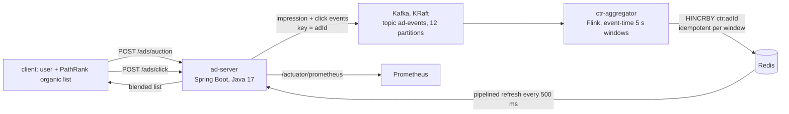

# PathRank ads: sponsored jobs with a real-time CTR loop

PathRank ranks jobs for a user. Job boards make money by letting employers pay to promote a job, so I wanted to see what it takes to mix paid results into those rankings without wrecking them. This folder is that: a Java/Spring Boot ad server that runs a second-price auction for sponsored slots in the PathRank result list, a Flink job that learns each ad's click-through rate from a Kafka stream of impressions and clicks, and a click simulator that closes the loop on real OLX users and jobs.



## What each piece does

| Piece | Code | What it does |
|---|---|---|
| ads-core | `ads-core/` (plain Java, no framework) | The ad logic, so it can be unit tested without Spring: GSP auction, budget ledger, frequency cap, slot blending, CTR smoothing, Thompson sampling |
| ad-server | `ad-server/` (Spring Boot 3.3) | `POST /ads/auction`: takes a user and the organic list, returns the list with sponsored jobs blended in. `POST /ads/click`: charges the click once. `GET /ads/stats`. Sends every impression and click to Kafka. Micrometer/Prometheus metrics |
| ctr-aggregator | `ctr-aggregator/` (Flink 1.20, DataStream API) | Reads `ad-events`, counts impressions and clicks per ad in event-time tumbling windows, and adds them to `ctr:<adId>` in Redis. Late and malformed events are counted, not silently dropped |
| campaigns | `sim/make_campaigns.py` | 500 campaigns on real OLX jobs, plus the hidden CTR the simulator clicks with |
| click simulator | `sim/click_sim.py` | Replays real OLX user ids against the server and clicks with the hidden CTR × position bias. Then checks what the system learned |
| load test | `bench/auction.js` (k6) | Throughput and latency of `POST /ads/auction` |
| bench | `bench/ads_bench.sh` | All of the above end to end, writes `results/RESULTS_ads.md` |

## How an auction works

1. **Filter.** Drop campaigns whose job is already in the organic list, whose advertiser can't afford one more click at their bid today, or that this user has already seen 3 times this hour.
2. **Rank.** Score = bid × pCTR (expected cost per impression). Ranking by bid alone would let a high bid buy the slot for a job nobody clicks.
3. **Price.** Generalized second price: the winner at position i pays the smallest price per click that still beats position i+1, `rankScore[i+1] / pCTR[i] + $0.01`, never above its bid, never below the $0.05 reserve.
4. **Blend.** Each winner only goes in if `SlotBlender` says its expected revenue beats the relevance it costs the organic list. This is a Java port of `sponsored_slot()` in `pathrank/notify/policy.py`, and `SlotBlenderTest` checks it against numbers from the Python version.
5. **Log.** Every sponsored row gets an impression id; the impression goes to Kafka. A click on that id is charged once (compare-and-set), only within 10 minutes, and only if the budget allows. An over-budget click is still logged, because it still tells us something about the ad's CTR.

## Design choices

- **The auction never waits on Redis.** CTRs are pulled from Redis in one pipelined round trip every 500 ms into a local map. The hot path is a map lookup. The cost is that CTRs are up to 500 ms staler than Redis, which doesn't matter next to 5 s windows.
- **Kafka sends are fire-and-forget.** The request thread doesn't wait for the broker ack. Send failures are counted (`ads.events.send_errors`) instead of failing the auction. The producer is idempotent (`acks=all`), and events are keyed by adId so one ad's events stay ordered on one partition, which is also how Flink keys them.
- **Event time, not arrival time.** Windows use the timestamp the server put on the event, with a 2 s out-of-order bound and idle-partition handling, so a slow partition can't hold every window open.
- **The Redis sink is idempotent per window.** A Lua script sets a marker key `ctrw:<adId>:<windowStart>` with NX and only increments the counts if the marker is new. If Flink restarts from a checkpoint and re-emits a window, the second write does nothing (`ads:duplicate_windows` counts these). This works because event-time windows with no allowed lateness fire once with the same counts.
- **Beta-smoothed CTR.** pCTR = (clicks + 1) / (impressions + 50), so a new ad starts at 2% instead of 0 or NaN.
- **Budgets and frequency caps are in memory.** That is fine for one ad-server instance. With more than one, both would move to Redis (atomic INCRBY for spend). The frequency check and record are not one atomic step, so two requests for the same user at the same instant can go one over the cap.

## Issue found and fixed: the auction never explored

The first version ranked ads by their mean pCTR. I tested ads-core behind a throwaway in-process server (no Kafka/Flink, synthetic data, 40K requests), and only 42 of 500 ads ever got 200+ impressions. New ads all start at the same 2% prior, so the highest bidders won every time and every other ad's CTR stayed unknown. The system could never find out that a lower bidder had a better CTR.

Fix: **Thompson sampling** (`ThompsonCtrSource`). Each request draws every ad's CTR from its Beta posterior instead of using the mean. An ad with little data has a wide posterior, so it sometimes draws high and gets shown. An ad with lots of data draws close to its real rate. Exploration fades on its own as the posteriors narrow. On the same harness, ads with enough data went from 42 to 99. `ads.exploration=none` switches it off for comparison. These harness numbers are only a sanity check, not results; the real numbers come from `make ads-bench`.

## What is real and what is simulated

- **Real:** OLX job ids, OLX user ids, the organic candidate pool (most popular OLX jobs), and the whole serving path (Spring Boot, Kafka, Flink, Redis).
- **Generated:** OLX has no ads, so bids, budgets and advertisers are generated with a fixed seed. Clicks are simulated: each ad has a hidden CTR, anchored to real behaviour (jobs whose OLX interactions are mostly deeper actions like bookmarks, chats and phone reveals get a higher CTR), times a position bias of 1 / log2(position + 2).
- The ad server never sees the hidden CTRs. It has to learn them from clicks through Kafka → Flink → Redis, and the simulator checks how well it did.
- The organic list is popularity-based, not the full PathRank ranker, so the load test measures the ad server alone.

## Running it

```bash
make stream-events          # OLX interactions.csv -> data/raw/olx/events.parquet (skip if you already have it)
make ads-test               # unit + Flink mini cluster + Testcontainers integration tests (needs Docker)
make ads-bench              # Kafka + Redis up, campaigns, Flink job, ad server, click sim, k6, report
```

Or one piece at a time: `make ads-up ads-build ads-campaigns`, then `make ads-flink` and `make ads-server` in two terminals, then `make ads-sim ads-load ads-report`. Knobs: `make ads-bench REQUESTS=500000 VUS=64 DURATION=120s`.

Try it by hand:

```bash
curl -s localhost:8090/ads/auction -H 'Content-Type: application/json' \
  -d '{"userId": 42, "organic": [{"jobId": 1, "score": 0.05}, {"jobId": 2, "score": 0.04}, {"jobId": 3, "score": 0.03}]}'
curl -s localhost:8090/ads/click -H 'Content-Type: application/json' -d '{"impressionId": "<id from above>"}'
```

## Tests

| Test | What it checks |
|---|---|
| `GspAuctionTest` | ranking by bid × pCTR, second-price math, price capped at bid, reserve, deterministic ties |
| `BudgetLedgerTest` | 5,000 concurrent clicks on 8 threads never overspend |
| `FrequencyCapperTest`, `CtrEstimateTest`, `ThompsonCtrSourceTest` | rolling-window caps, smoothing, posterior sampling and the gamma sampler |
| `SlotBlenderTest` | same numbers as the Python `sponsored_slot()` |
| `AdDecisionEngineTest` | filtering, placement positions, caps and budgets together |
| `AdServiceTest` (Mockito) | blended list, events published, click charged once, TTL, over-budget clicks |
| `CountAggregateTest`, `CtrWindowJobTest` | the Flink windowing pipeline on an embedded mini cluster |
| `AdServerIntegrationTest` (Testcontainers) | the whole service against real Kafka and Redis: Redis CTRs change who wins, events land on Kafka, 409 on double click, Prometheus metrics |

## Results (MacBook Air M3, real OLX users, simulated clicks)

Both runs are `make ads-bench REQUESTS=200000 DURATION=60s` on the real OLX events (65.5M events, users and jobs from `data/raw/olx/events.parquet`). The second run multiplies every daily budget by 100 (`BUDGET_SCALE=100`) so budgets never run out. Full tables: [`results/RESULTS_ads_olx.md`](../results/RESULTS_ads_olx.md) and [`results/RESULTS_ads_olx_nobudget.md`](../results/RESULTS_ads_olx_nobudget.md).

| What | Budgets on | Budgets off |
|---|---|---|
| Auction throughput (k6 native, 32 VUs, 60 s) | **29,247 req/s**, 0 failed | **27,449 req/s**, 0 failed |
| Auction latency p50 / p95 / p99 | 0.65 / 2.51 / **5.02 ms** | 0.67 / 2.71 / **5.68 ms** |
| Event -> Redis CTR freshness p50 / p95 (5 s windows) | 2.5 s / 5.8 s | 2.5 s / **6.1 s** |
| Late / malformed events, re-emitted windows | 0 / 0 / 0 | 0 / 0 / 0 |
| Click sim: requests, errors | 200,000, 0 | 200,000, 0 |
| Impressions / clicks | 142,019 / 1,019 | 191,379 / 1,483 |
| pCTR vs hidden CTR, Spearman | 0.667 | 0.528 |
| Impressions to the best quarter of ads, first -> last 10% of requests | 27.4% -> 23.8% | **22.3% -> 82.2%** |
| Sponsored CTR, first -> last 10% | 0.60% -> 0.64% | **0.56% -> 0.94% (+68%)** |
| Budget-filtered candidates / blender-rejected winners | 2,744,685 / 257,981 | 0 / 208,621 |

What I take from these:

- **The auction is fast.** 27-29K requests/s with p99 under 6 ms, and that's with k6, Kafka, Flink and Redis all on the same laptop. One earlier synthetic run measured 16K req/s right after another long run; I think that was the fanless Air throttling, so I quote the range rather than the best number.
- **The feedback loop learns.** With budgets off, the share of impressions going to the best quarter of ads went from 22% (about random) to 82%, and sponsored CTR went up 68%. Ads -> Kafka -> Flink -> Redis -> auction is closing the loop. The last-10% CTR comes from only 44 clicks on 4,689 impressions, so it's noisy, but the lift is still significant (z = 2.6).
- **Budgets hid the learning.** With real budgets, the best ads get the most clicks, spend their daily budget first and drop out, so by the end only 942 of 40,000 slots were filled. Real ad systems solve this with budget pacing (spreading spend over the day), which is the next thing I'd build.
- **The slots stopped filling, and that's the blender doing its job.** The OLX-anchored CTRs average 1.3%, below the 2% prior every new ad starts at. As the estimates came down to the real rates, `SlotBlender` decided most ads weren't worth pushing an organic job down and rejected 209K placements. The system learned that most of these ads weren't worth the slot.
- **Lower Spearman with budgets off is expected.** Once the auction knows an ad is weak it stops showing it, so that ad's estimate stays noisy. That's the explore/exploit trade-off, not a bug.

## What I'd do next

- **Budget pacing**: throttle each advertiser so spend is spread over the day instead of gone in the first hour.
- **Budgets and frequency caps in Redis**, so more than one ad-server instance can run.
- **Use the real PathRank ranker** for the organic list instead of the popularity baseline, and calibrate its scores so the blending rule compares like with like.
