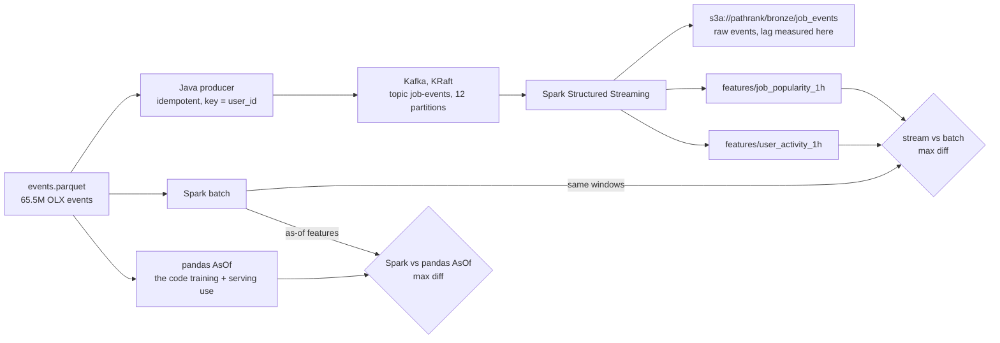

# PathRank streaming path: Kafka → Spark → S3

The batch pipeline already builds features from the OLX events with pandas. Here I wanted to see what the same data looks like as a stream: replay the 65.5M OLX events into Kafka, compute features with Spark Structured Streaming, land them in S3 (MinIO locally), and then show that the Spark features match the pandas ones exactly.



## What each piece does

| Step | Code | What it does |
|---|---|---|
| 1 | `deploy/docker-compose.yml` (profile `streaming`) | One Kafka broker in KRaft mode (no ZooKeeper) and MinIO with a `pathrank` bucket, next to the existing Redis/Triton/API stack |
| 2 | `streaming/producer/` (Java 17, Maven, kafka-clients 3.9) | Reads `events.parquet` row by row and sends each event to `job-events`, keyed by `user_id`, with `enable.idempotence=true`, `acks=all`, lz4, 10 ms linger. Writes throughput and producer metrics to JSON |
| 3 | `pathrank/streaming/stream.py` (PySpark 4.0) | Three queries on the topic: raw events to `bronze/` (this is where I measure lag), and 1-hour tumbling windows of job popularity and user activity with a 1-hour watermark, written as Parquet to MinIO |
| 4 | `pathrank/streaming/batch.py`, `parity.py` | Spark batch over the full Parquet. (a) Recomputes the pandas `AsOf` features (`job_pop_all`, `job_pop_7d`, `user_n_apps`, `user_last`) and compares them to the real `AsOf` class. (b) Recomputes the same hourly windows and compares them to what the stream wrote |
| 5 | `pathrank/streaming/report.py` | Turns `results/streaming/*.json` into `results/RESULTS_streaming.md` and the table in the main README |

## Running it

```bash
pip install -r requirements-streaming.txt      # pyspark 4.0.1; Spark 4 needs Java 17+ (brew install openjdk@17)
make stream-up                                 # Kafka + MinIO in Docker
make stream-producer-build                     # streaming/producer/target/olx-replay-producer.jar
make stream-events                             # interactions.csv -> data/raw/olx/events.parquet (sorted by time)
make stream-bench                              # all numbers below, then fills the README table
```

`make stream-bench` runs `scripts/stream_bench.sh`, which does:

1. **Producer throughput.** Full 65.5M replay at max rate into a separate topic (`job-events-bench`), so the stream run below isn't polluted. Also a `--dry-run` pass (read Parquet + build JSON, no Kafka) to show whether the reader or Kafka is the limit.
2. **Lag run.** Starts the Spark job on an empty `job-events`, waits until it's ready, then replays the first `LAG_N` events (default 5M) at a fixed `RATE` (default 50K events/s). Stops after 30 s with no new data.
3. **Stream parity.** Stream windows vs batch windows on the same events, and rows landed in bronze vs rows the producer got acks for.
4. **Batch parity + timing.** Spark batch vs pandas on the full 65.5M events.
5. **Report.**

Change the knobs with env vars, e.g. `make stream-bench RATE=100000 LAG_N=10000000`.

No Docker? `make stream-smoke` runs the streaming job and both parity checks on synthetic events, using Parquet files shaped like Kafka records instead of a broker and a local folder instead of MinIO. CI (`.github/workflows/streaming.yml`) builds the producer and runs the full Docker version on 1M synthetic events.

## How I measure each number

- **Producer throughput** = acked records / (first send → `flush()` returned). Only acked records count, so it's not just "how fast I can call `send()`".
- **End-to-end lag** = for every row, (time the bronze Parquet write to S3 returned) − (Kafka record timestamp, which is the producer's send time). I keep an exact histogram in 1 ms buckets and take nearest-rank p50/p95/p99. Everything runs on one laptop, so there is one clock.
  - Lag depends on the replay rate and the 5 s trigger. If the producer sends faster than Spark can process, the lag just grows with the backlog and the number means nothing, so the lag run is rate-limited and the rate is reported next to it.
- **Spark vs pandas runtime**: same input file, same output features. pandas time = read Parquet + the OLX loader's `to_schema` (dedup, ≥2-interaction users) + `AsOf`. Spark time = read + the same steps + writing the features to the lake. Spark session startup is not included. `AsOf` also builds a few things Spark doesn't (the job catalog, per-user history arrays), so pandas is doing slightly more work.
- **Feature parity**: outer join on user/job id, so a missing row counts as a failure, not just a value difference. NaN must match NaN (`user_last` for users with no history before the cutoff).

## Design choices

- **Key = user_id.** All events of one user land on one partition in order, which is what you'd want if a downstream consumer keeps per-user state.
- **Idempotent producer.** With `acks=all` and ≤5 in-flight requests, a retried batch can't be written twice. The stream parity check verifies this end to end: duplicates are counted by distinct (partition, offset), and rows landed must equal rows acked.
- **Bronze writes are idempotent per micro-batch.** `foreachBatch` writes to `bronze/job_events/batch_id=N/` with overwrite, so if Spark retries a batch after a crash it replaces its own output instead of adding rows.
- **Event time, not Kafka time, for windows.** Windows use the OLX timestamp (2020), so replaying at 50K/s still gives the same hourly windows the batch job computes. That's why stream and batch can be compared exactly.
- **The windowing code is shared.** `job_popularity()` and `user_activity()` are plain DataFrame functions; the stream calls them with a watermark and the batch job calls them without one. Same code, so a mismatch means data was lost or dropped, not that I wrote two different formulas.
- **Checkpoints on local disk, data in S3.** Checkpointing to S3 works but is slow and S3A renames aren't atomic.

## Results (MacBook Air M3, 8 cores, Docker Desktop, Java 17)

| What | Number |
|---|---|
| Producer throughput, full 65.5M replay | **1.49M events/s** (102 MB/s), 0 errors, 0 retries. An earlier run did 1.69M/s |
| Parquet read + JSON build only (`--dry-run`) | 2.96M events/s |
| Kafka → S3 lag, 50K/s, 5 s trigger | p50 5.9 s, p95 8.7 s, p99 9.5 s |
| Kafka → S3 lag, 50K/s, 1 s trigger | **p50 1.5 s, p95 4.0 s**, p99 5.3 s |
| Kafka → S3 lag, 150K/s, 1 s trigger | p50 7.2 s, p95 10.5 s. Spark only processed 127.9K/s, so it fell behind |
| Spark batch vs pandas, 46.4M user-job pairs | Spark 102 s vs pandas 46 s |
| Spark vs pandas `AsOf` features | **max diff 0** (2,570,548 users, 176,644 jobs) |
| Stream vs batch windows | max diff 0, 2.52M windows matched, 0 closed windows missing |
| Kafka → S3 completeness | 5,000,000 acked → 5,000,000 in S3, 0 duplicates |

What I take from these:

- **The producer is limited by Kafka, not by my code.** Reading Parquet and building the JSON alone runs at about 3M events/s, and sending with `acks=all` and idempotence runs at about 1.5M/s. Run to run it moved between 1.49M and 1.69M/s, so I quote it as ~1.5M/s.
- **At a load Spark can handle, lag is mostly the trigger interval.** With a 5 s trigger an event waits on average half a trigger before its batch even starts, so p50 was 5.9 s. Dropping the trigger to 1 s cut p50 to 1.5 s. p95 only went from 8.7 s to 4.0 s, because now the tail is the batch itself: three queries share 8 cores and every batch writes Parquet to MinIO.
- **The laptop tops out around 128K events/s.** At 150K/s Spark processed 127.9K/s, batches grew to ~625K rows each, and lag kept rising for as long as I sent data. That run was only ~33 s, so 128K/s is an approximate ceiling, not a careful one. Between 50K/s (fine) and 150K/s (falling behind) is where it breaks.
- **Spark was 2.2× slower than pandas, and that's expected on one machine.** 46M rows fit in RAM, so pandas does it in one process with no shuffle. Spark in local mode pays for shuffles, the JVM and Python boundary, and writing results to S3. I didn't tune it to win. What I wanted from this step was the parity: Spark gives exactly the same features as the code the model trains on, so if the data outgrows one box I can move this step to Spark without changing a single value.

## What I'd do next

- Merge the three streaming queries into one `foreachBatch` that reads and parses Kafka once. Right now each query reads the topic and parses the JSON on its own, which is probably most of the per-batch cost that sets the 128K/s ceiling.
- Run the ceiling test longer (the full 65.5M at a few rates) to get a real max sustainable throughput.
- Try Avro or Protobuf instead of JSON values. JSON is easy to debug but it's 69 bytes per event and has to be parsed on every read.

## Things I learned / limits

Setup problems I hit, so the next run is faster:
- **Java must be 17 (or 21).** On JDK 24+ the Parquet reader dies with `getSubject is supported only if a security manager is allowed`, because Hadoop still calls an API the newer JDKs removed, and Spark 4.0 has the same problem. Fix: `export JAVA_HOME="$(brew --prefix openjdk@17)/libexec/openjdk.jdk/Contents/Home"; export PATH="$JAVA_HOME/bin:$PATH"`.
- **`minio/minio` is gone from Docker Hub** (Sep 2026), so compose uses `cgr.dev/chainguard/minio`, and the bucket is created from Python instead of an `mc` container.
- **Spark `--packages` failing with `[NOT FOUND] ... local-m2-cache`.** The Maven build left only `.pom` files in `~/.m2` for `snappy-java` and `slf4j-api`, and Spark's resolver trusted them. Deleting those two folders from `~/.m2` and `~/.ivy2.5.2/cache` fixed it.


- The last hour of events never leaves the stream: in append mode a window is written only once the watermark passes its end, and after the replay finishes there's no newer event to move the watermark. The parity check reports these as `open_at_end` and only fails on missing windows that should have closed.
- Spark's default 200 shuffle partitions made every micro-batch slow on a laptop; 8 is set for streaming.
- Local mode on one machine means Kafka, MinIO and Spark compete for the same cores, so these are laptop numbers, not cluster numbers.
- The windowed features are new streaming features. The model still trains on the batch `AsOf` features; the as-of parity check is what shows Spark could replace pandas for those without changing a single value.
